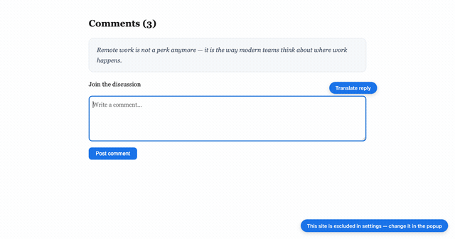
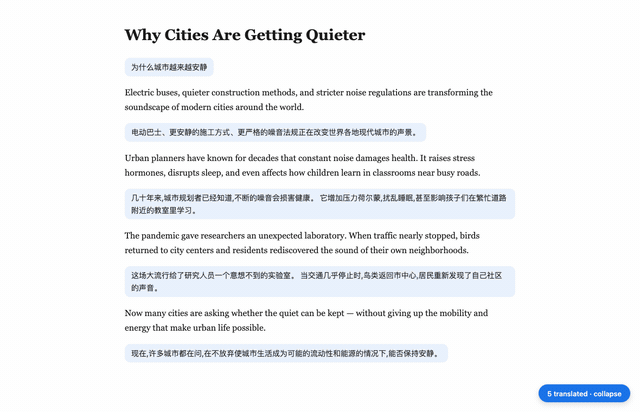
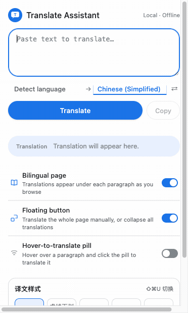
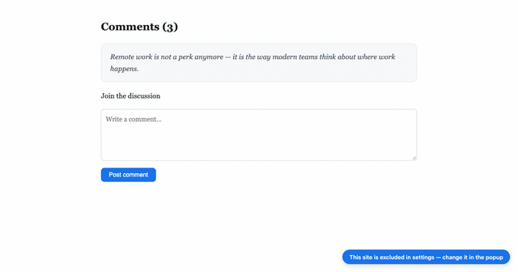
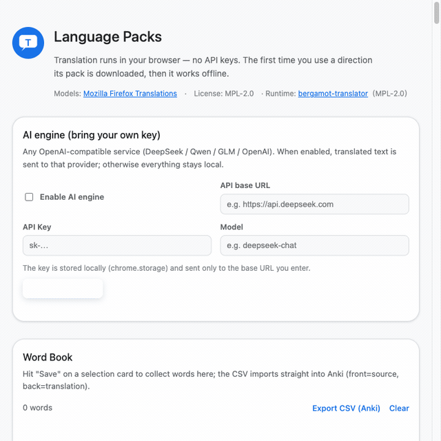
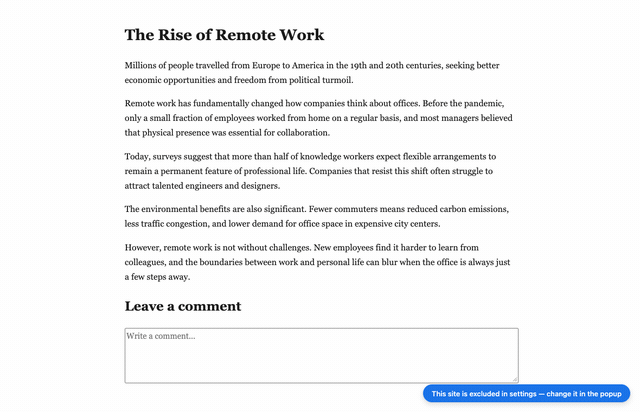

<div align="center">

# Translate Assistant

**Draft in your own language, the translation replaces your draft in place — fully usable without an API key, no uploads, offline once packs are installed**

*Write-back translation for Chrome: type a reply in your language and the translation lands in the box, plus bilingual full-page view and select-to-translate. A Google Translate / Immersive Translate alternative that works in full without an API key and sends nothing anywhere by default.*

[简体中文](README.md) | **English README**

[](LICENSE)
[](https://www.google.com/chrome/)
[](https://github.com/DreamOfXM/translate-assistant/pulls)



*Type your reply in your own language, right in the page's own text field → click "Translate reply" → a card pops up next to it → click "Fill in" and the translation replaces your draft in place. The send button stays yours*

</div>

---

## ✨ What it does

| | Feature | Details |
| --- | --- | --- |
| ✍️ | **Write-back translation** | Draft a reply in your own language in any comment box; the translation **replaces the draft in place** — **only after you confirm**, never auto-posted |
| 📖 | **Bilingual page** | Open a foreign page and translations appear under each paragraph. Only the article body — nav, ads and comment sections are never touched; per-site "never translate" lives in the popup |
| 🔍 | **Select to translate** | Select any foreign text, click the floating pill, get a result card in place |
| 👆 | **Hover to translate** | Hover a paragraph, click the pill that appears — just that one paragraph gets translated |
| 🎨 | **Five translation styles** | Color block, dashed underline, marker, blur-to-read and translation-only. Picked in the popup, applied everywhere instantly; `Alt+C` cycles through them |
| ⚡ | **Three engines, picked automatically** | Chrome's built-in model (138+) first, the extension's bundled offline engine as fallback; you can also plug in your own AI service (off by default) |
| 📴 | **Offline** | Install a language pack once and translation keeps working without a network |
| 🔒 | **Privacy first** | By default every translation happens on your device — page text, drafts and results are never uploaded. The AI engine is off by default; only if you enable it with your own key does the AI-bound portion of text go to the provider you chose |

<p align="center">
  
  
  
</p>

## ✍️ Write-back translation: type in your language, the translation lands in the box

Reading foreign pages needs translation. Writing a reply back needs it more. This feature does the **last step**: draft in your own language in a comment box, a post box or a webmail composer, hit "translate reply", confirm — and your draft is replaced by the translation, in place. The send button stays yours.

The hard part isn't translating, it's writing. Filling a text box looks like one assignment and is where this kind of product breaks most often, so our write-back **has to prove it worked**:

- **Whole-replacement only**: after writing, we re-read the box and require it to be *exactly* the translation. Anything appended after your draft — half in one language, half in the other — counts as a failure
- **Three channels, roll back on damage**: `execCommand` insert → native select-all then insert → synthetic paste event. Editors like Reddit's Lexical block the first two but honour paste; if a write mangles the draft we undo it, re-checking after each step rather than leaving your text half-destroyed
- **Works on React-controlled inputs**: we bypass the framework's value setter and re-fire `input` / `change` — otherwise the box looks filled while the framework still holds an empty state, and "send" posts nothing
- **Composers inside iframes too**: most webmail bodies live in an iframe, and that's still covered
- **Your draft never leaves the device**: both engines run locally. It's the draft, not the page you opened, that deserves privacy

> A few rich-text editors reject programmatic writes entirely. Then the translation goes straight to your clipboard and the panel says so in as many words — select all, paste. It never claims a success it didn't get.
> Input boxes in desktop apps (mail clients, chat apps, notes) are out of a browser extension's reach — on macOS the [menu bar app](macos/README.md) below covers them through the system accessibility API, on the same engine.

## 🌐 Translation engines: on your device by default

Two local engines ship with the extension, and it picks whichever fits — either way **your text is never uploaded**.

| | Engine | When it's used |
| --- | --- | --- |
| ⚡ | **Chrome built-in translation**<br>(Chrome 138+) | Preferred whenever the browser already has the on-device model for that language pair. Chrome downloads and manages the model itself; per Chrome's documentation, no data is sent to Google or third parties when the model is used |
| 📦 | **Local language packs**<br>[bergamot-translator](https://github.com/browsermt/bergamot-translator) (same engine Firefox Translations uses, MPL-2.0) | Fallback whenever the above isn't available — and the only option offline, on intranets, or in airplane mode |

> Chrome gates the built-in model download behind a user gesture: it only starts when you click **Translate**, never silently.
> Until the model is ready, that first translation is served by the local language pack while the download continues in the background; later paragraphs switch over automatically.

<details>
<summary><b>Optional: bring your own AI (off by default)</b></summary>

The **AI engine** section in the pack manager accepts any OpenAI-compatible service (DeepSeek / Qwen / GLM / OpenAI) — endpoint plus your own key. Once enabled, translations prefer the AI route for a higher quality ceiling; the trade-off is that **the AI-bound portion of text goes to the provider you chose**, under that provider's billing and quota. The UI always labels which engine produced a given translation. Leave it off and everything stays local, exactly as before.

</details>

## 📥 Language packs: install once, offline forever

Models come from Mozilla's public [Firefox Translations](https://github.com/mozilla/firefox-translations-models) catalog (116 directions, MPL-2.0).

<p align="center">
  
</p>

- **On-demand download**: a pack (10–50 MB, most around 25 MB) is fetched the first time you use a direction, with the size shown up front
- **Offline runtime**: once installed, translation is fully local — airplane mode included
- **Integrity checked**: model files are SHA-256 verified; corrupted files are discarded automatically
- **Relay for non-English pairs**: Mozilla only publishes X↔English models, so pairs like Chinese↔Japanese relay through English (the UI tells you when two packs are needed)

## 🎨 Translation styles & shortcuts

The same bilingual page reads differently depending on what you're there for: five styles, switchable in the popup with instant global effect, or cycled with `Alt+C`.

<p align="center">
  
</p>

*Pick a style in the popup and every translation already on the page re-styles instantly; all five styles in sequence*

| Style | Best for |
| --- | --- |
| Color block (default) | Translation stands out at a glance; the general case |
| Dashed underline | The quietest — long articles stay uncluttered |
| Marker | Highlighter feel for passages you want to spot |
| Blur to read | Original blurred out — force yourself to read the foreign text first |
| Translation only | Just the information, no side-by-side |

| Shortcut (default) | Action |
| --- | --- |
| `Alt+T` (macOS ⇧⌘Y) | Toggle the bilingual page |
| `Alt+C` (macOS ⇧⌘U) | Cycle translation styles |

> Shortcuts can be changed at `chrome://extensions/shortcuts`. The popup's corner shows your actual current binding; if it says "No shortcut", click it to jump straight to that settings page. On macOS `Alt+T` / `Alt+C` work as well — the extension listens inside the page directly, independent of Chrome's binding.

## 📦 Install

### Option 1: download a build (recommended)

1. Grab the latest `translate-assistant-vX.Y.Z.zip` from [Releases](https://github.com/DreamOfXM/translate-assistant/releases)
2. Unzip it anywhere
3. Open `chrome://extensions` → enable **Developer mode** → click **Load unpacked** → select the unzipped `translate-assistant` folder
4. Refresh already-open pages (the content script only injects into newly loaded ones)

> Unpacked extensions require developer mode; the extension contains zero telemetry, and the source is all here to audit.

### Option 2: build from source (developers)

Requires Chrome 109+ (offscreen documents API) and Node.js 18+.

```bash
npm install
npm run build
```

The build lands in `dist/translate-assistant` (load it as above) and also produces a distributable `dist/translate-assistant-v<version>.zip`.

> ⚠️ Load `dist/`, never `extension/`: `content.js` must be bundled by esbuild into a single classic script.

## 🚀 Quick start

1. **Install a pack**: click the extension icon → **Manage packs** → download the direction you need (e.g. en→zh)
2. **Read foreign pages**: just open them — translations appear automatically; the floating button collapses everything
3. **Reply in foreign languages**: hit **Translate reply** in a comment box or in a webmail compose box, write in your language, generate, confirm, fill in
4. **Read it your way**: pick a style in the popup's **Translation styles** or cycle with `Alt+C`; hit **Save word** on a selection card to build a vocabulary list that exports as Anki CSV

The UI speaks **中文 / English** — it follows your browser language and can be switched on the welcome page or in the pack manager.

## 🖥️ macOS menu bar app

> This section is for macOS users only; Windows / Linux users can skip it — the extension itself uses no platform-specific features.

A browser extension can only see the pages it injects into. To translate the input
field of **any app** (Notes, mail clients, chat apps) on the same engine,
the repo also ships a macOS menu bar app.

```bash
npm run build:macos
open macos/dist/TranslateAssistant.app
```

- `⌃⌥T` translates the focused input field, `⌃⌥Y` translates the selection; confirm in
  the panel and the result is written back in place
- Reuses the **same** Bergamot WASM engine and the same language packs, fully offline
- Reads and writes the focused field through the system Accessibility API, so it needs
  a one-time Accessibility grant
- **Translate this page in the app** in the menu: full-page bilingual in the app's own
  window, no extension needed. It only asks the browser for the active tab's *URL* —
  the window reloads the page itself — so the grant it needs is Automation, not Accessibility
- The panel deliberately never steals focus; focus is handed back to the target app
  before writing

Scope, permission steps and known blind spots: [macos/README.md](macos/README.md).

## ⚠️ Known limitations

- Models are English-centric: non-English pairs relay through English, costing some speed and quality
- The Chrome built-in engine needs Chrome 138+; which language pairs it covers is Chrome's call, and it cannot be provisioned for offline use — when it isn't available the extension falls back to local language packs, so nothing breaks
- The WASM runtime is about 5 MB and loaded packs noticeably raise memory (traded for no cold start on the second translation)
- Language and main-content detection are lightweight heuristics; exotic pages may be misjudged (biased toward translating more, never less)
- Only pages rendered by the browser are in scope. Input fields inside desktop clients (mail apps, chat apps, note apps) are out of reach for any extension; webmail in a browser does work, including compose boxes that live inside an iframe. On macOS those fields are covered by the [macOS menu bar app](macos/README.md) (macOS only), which goes through the system Accessibility API instead of the browser
- Some rich-text editors reject programmatic input; the panel then suggests copying instead

## 🛠️ Releasing / Contributing

```bash
npm run release             # patch 1.1.0 → 1.1.1: test → build → tag → bilingual Release in one go
npm run release -- minor    # minor 1.1.0 → 1.2.0
RELEASE_NOTES_ZH="..." RELEASE_NOTES_EN="..." npm run release   # custom release notes
DRY_RUN=1 npm run release   # rehearsal: build only, no push
```

Requires a logged-in `gh` CLI. For everyday development please run `npm test` and `npm run test:e2e` first.

## 🧭 Project layout

```text
extension/
  manifest.json       MV3 manifest (minimal permissions: storage / contextMenus / offscreen)
  background.js       service worker: message routing + offscreen lifecycle
  offscreen.html/js   offscreen document: WASM engine host
  content.js          page interactions: selection card / reply panel / bilingual page / hover pill
  lib/                reusable modules (i18n / languages / text / engine bridge / content extraction…)
  ui/                 popup, pack manager, welcome page
  icons/              both toolbar icon sets, zh and en (sources are icon*-src.svg)
  _locales/           manifest name/description message catalogs (中文 / English)
  vendor/             bergamot-translator 0.4.9 (MPL-2.0)
tests/unit/           unit tests (node:test + jsdom)
tests/e2e/            Playwright end-to-end smoke tests
macos/                macOS menu bar app (Accessibility API reads/writes any input field, same
                      engine; plus an in-app page window for bilingual reading without the extension)
scripts/              packaging and engine verification
docs/images/          demo GIFs for the README (zh + en sets)
LICENSE               full MPL-2.0 license text
```

## 📄 License

[MPL-2.0](LICENSE). The translation runtime and language models follow their upstream licenses (see "Language packs").
